# Diagrama de arquitectura MVT

**Objetivo.** Mostrar el recorrido entre navegador, Django y MariaDB, tanto al procesar datos como al presentar la respuesta.

```mermaid
flowchart LR
    subgraph cliente["Navegador"]
        navegador["Interfaz HTML y CSS"]
        js["validaciones.js"]
        webgl["Visor Three.js y GLTFLoader"]
        geometria["GLB estático por categoría"]
        carrusel["Carrusel y diálogo de especificaciones"]
        js -->|Controla los campos| navegador
        webgl -->|Dibuja y gira el prototipo| navegador
        carrusel -->|Aplica acabado del registro| webgl
        geometria -->|Proporciona geometría y materiales| webgl
        carrusel -->|Presenta la ficha seleccionada| navegador
    end
    subgraph django["Aplicación Django"]
        rutas["URLs del proyecto y de instrumentos"]
        vistas["Funciones de views.py"]
        galeria["Funciones de galeria.py"]
        mundo["Vistas de Mundo musical"]
        articulos["Artículos editoriales versionados"]
        formulario["InstrumentoForm"]
        modelo["Modelo Instrumento"]
        orm["ORM de Django"]
        plantillas["Templates HTML"]
        rutas -->|Despacha| vistas
        rutas -->|"Portada y salas"| galeria
        rutas -->|"Portada y lectura"| mundo
        mundo -->|"Lee contenido fijo"| articulos
        mundo -->|"Artículo o portada"| plantillas
        galeria -->|"Lee por categoría"| modelo
        galeria -->|"Vitrinas y datos de la sala"| plantillas
        vistas -->|Alta y edición| formulario
        vistas -->|Consulta y borrado| modelo
        formulario -->|Valida y guarda| modelo
        modelo --> orm
        vistas -->|Contexto para render| plantillas
    end
    base[("MariaDB")]
    navegador -->|Solicitud HTTP| rutas
    plantillas -->|HTML de respuesta| navegador
    vistas -->|Redirección HTTP| navegador
    orm <-->|SQL y resultados| base
```

Las rutas identifican la vista. La vista coordina el acceso a los datos y utiliza el formulario al escribir por alta o edición. Los templates producen HTML y el fragmento de campos carga el JavaScript que se ejecuta en el navegador. La conexión a MariaDB se configura en Django y el ORM genera las consultas.

## Referencias

- [Arquitectura MVT](../02_arquitectura/mvt.md) · [Rutas](../../instrumentos/urls.py) · [Vistas](../../instrumentos/views.py) · [Configuración](../../tienda_musica/settings.py)
- [Fragmento de campos](../../instrumentos/templates/instrumentos/_campos_formulario.html) · [JavaScript](../../instrumentos/static/instrumentos/js/validaciones.js)
