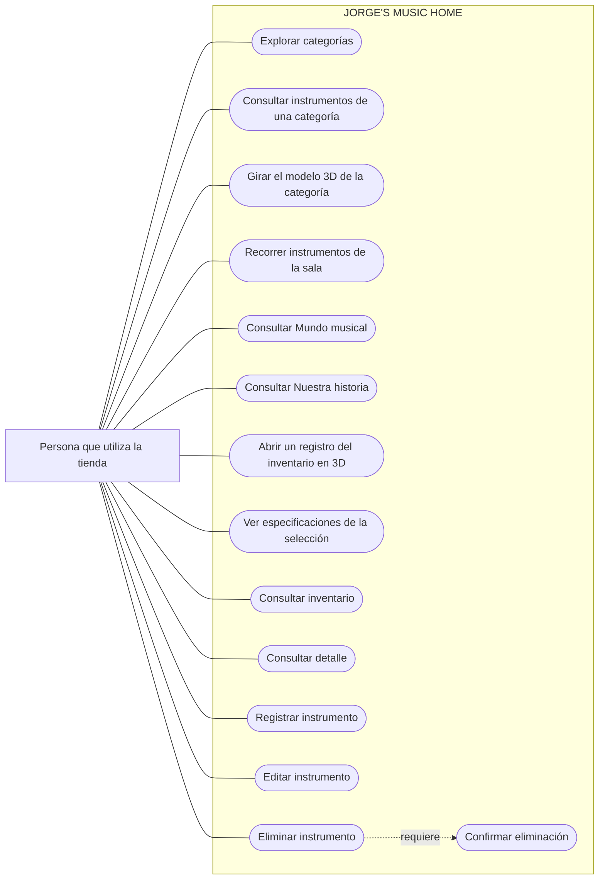

# Diagrama de casos de uso

**Objetivo.** Mostrar las acciones del operador en la galería y el inventario web.

La exploración abre cuatro salas de solo lectura. Cada una permite recorrer sus registros y girar su GLB cuando está disponible. El vínculo punteado indica que el borrado requiere confirmación. [Casos de uso del inventario](../04_casos_de_uso/crud.md) · [Casos de uso de la galería](../04_casos_de_uso/galeria.md)

## Referencias

- [Rutas](../../instrumentos/urls.py) · [Funciones CRUD](../../instrumentos/views.py) · [Confirmación de eliminación](../../instrumentos/templates/instrumentos/confirmar_eliminar.html)
