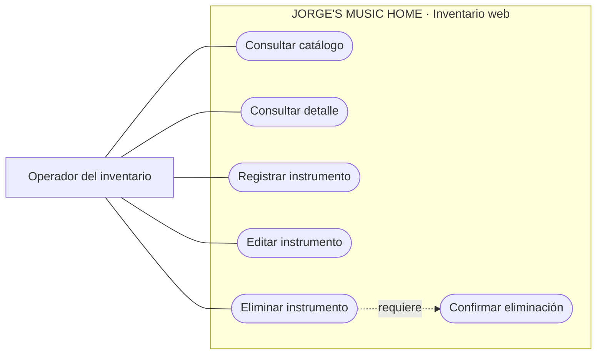

# Diagrama de casos de uso

**Objetivo.** Mostrar las acciones del operador dentro del inventario web y dónde termina el alcance del sistema.

El operador representa a la persona que utiliza la interfaz local. El CRUD actual está disponible sin iniciar sesión. El recuadro agrupa las acciones del inventario y el vínculo punteado indica que el borrado requiere confirmar el envío. Los métodos y casos alternativos están en el [documento de casos de uso](../04_casos_de_uso/crud.md).

## Referencias

- [Rutas](../../instrumentos/urls.py) · [Funciones CRUD](../../instrumentos/views.py) · [Confirmación de eliminación](../../instrumentos/templates/instrumentos/confirmar_eliminar.html)
