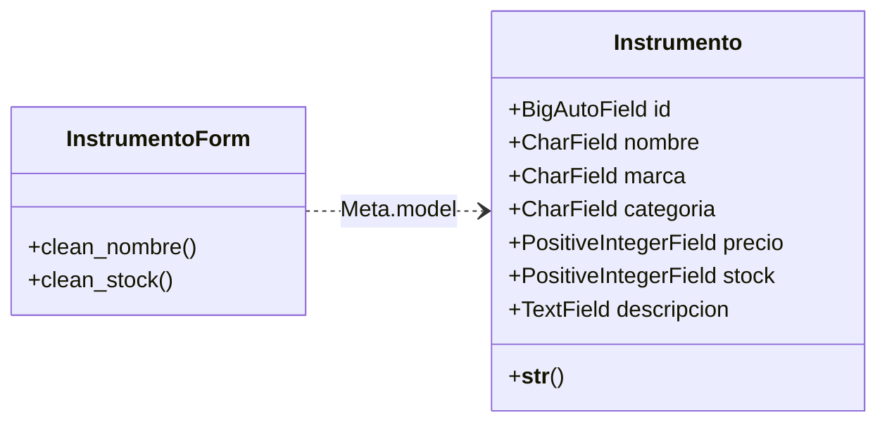

# Diagrama de clases

**Objetivo.** Identificar la entidad persistente y el formulario que la valida en alta y edición.

`Instrumento` representa una fila de `instrumentos_instrumento`. Django aporta la clave primaria `id` de tipo `BigAutoField`. Los campos de texto corto tienen un máximo de 20 caracteres en el modelo y la descripción es opcional en el formulario.

`InstrumentoForm` es una subclase de `forms.ModelForm`. Su `Meta.model` apunta a `Instrumento`, y su lista de campos editables excluye el identificador. La dependencia muestra que el formulario crea una instancia o trabaja con la instancia que la vista le entrega para edición. `is_valid()` y `save()` son métodos heredados. Las vistas CRUD son funciones y se representan en los diagramas de arquitectura y flujo.

## Referencias

- [Modelo](../../instrumentos/models.py) · [Formulario](../../instrumentos/forms.py) · [Clave primaria en la migración inicial](../../instrumentos/migrations/0001_initial.py)
