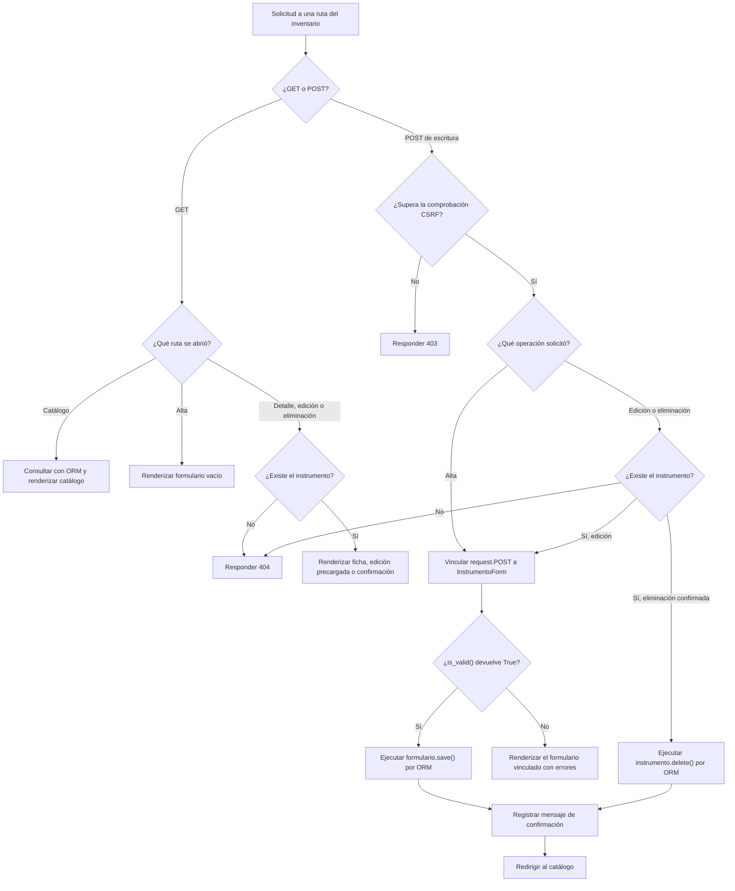

# Diagrama de flujo CRUD

**Objetivo.** Mostrar las decisiones del servidor para solicitudes GET y POST, incluido el tratamiento de entradas inválidas y del borrado protegido.

El diagrama se centra en los métodos usados por la interfaz. En edición, el formulario recibe la instancia encontrada. En eliminación, el GET solo presenta la confirmación. Cancelar vuelve al catálogo sin enviar el POST. El middleware comprueba CSRF antes del POST de escritura y `is_valid()` se usa únicamente en alta y edición.

## Referencias

- [Vistas CRUD](../../instrumentos/views.py) · [Middleware en settings.py](../../tienda_musica/settings.py) · [Confirmación de eliminación](../../instrumentos/templates/instrumentos/confirmar_eliminar.html) · [Pruebas HTTP](../../instrumentos/tests.py)
