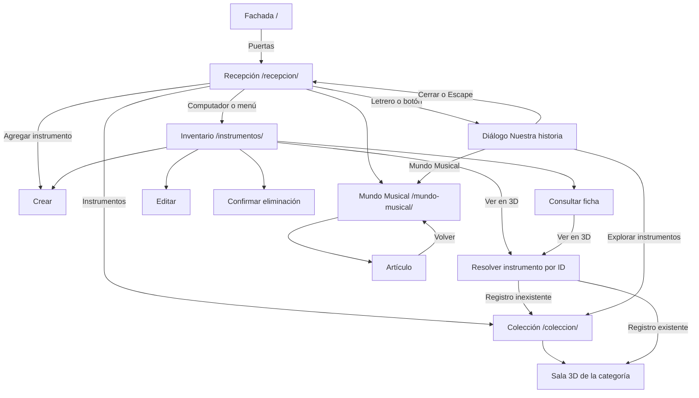

# Mapa de navegación

**Objetivo.** Mostrar el recorrido web desde la fachada y los accesos que comparten la Recepción y el Inventario.

El acceso por ID funciona también para instrumentos sin stock. Los formularios de alta y edición redirigen al inventario al guardar. La eliminación requiere confirmación y POST con CSRF. El cierre del diálogo devuelve el foco al acceso que lo abrió. [Rutas](../../instrumentos/urls.py) · [Arquitectura MVT](../02_arquitectura/mvt.md)
