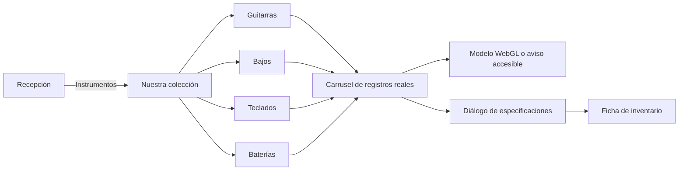

# Galería musical

## Requisitos implementados

| Requisito | Comportamiento |
| --- | --- |
| Acceso desde la recepción | El menú Instrumentos y las seis guitarras interactivas llevan a `/coleccion/`. |
| Explorar categorías | Cuatro vitrinas con su imagen aprobada, el nombre de la categoría y el enlace «Explorar colección». |
| Consultar una sala | Django muestra los registros actuales de su categoría y enlaza a las fichas. Baterías usa la clave interna `Percusion`. |
| Manipular el prototipo | Cada sala permite girar su malla con arrastre, toque o flechas sobre el lienzo. La flotación puede pausarse y se desactiva con movimiento reducido. |
| Recorrer una sala | Las flechas laterales recorren todos los registros de forma circular. El modelo sale y entra desde lados opuestos y recupera la orientación inicial con el acabado de la nueva marca. |
| Consultar especificaciones | Un diálogo muestra nombre, marca, categoría, modelo y descripción, precio CLP, stock y acabado de la selección. Escape, el botón Cerrar o un clic fuera devuelven el foco al botón de apertura. |
| Continuidad de navegación | Los enlaces siguen accesibles con WebGL desactivado y en salas vacías. |

## Caso de uso · Explorar una categoría

La persona abre **Instrumentos** en la recepción y activa **Explorar colección** en una vitrina. Django valida la ruta, consulta la categoría y presenta sus registros. En la sala, la persona usa las flechas laterales y abre **Ver especificaciones** para consultar el registro activo. Cerrar el diálogo conserva la selección y su orientación. Con el lienzo enfocado, las teclas de flecha giran el modelo. El diálogo ofrece un enlace opcional a la ficha existente. **Volver a las categorías** devuelve a la galería.

Si la sala está vacía, aparece un aviso. Con un registro, la ficha está disponible y las flechas se ocultan. Una categoría desconocida devuelve 404. Si falla WebGL o la geometría, el carrusel conserva la navegación y las especificaciones sin animación. Si el módulo no carga o JavaScript está desactivado, se muestran fichas desplegables.

## Modelos y alcance futuro

Las cuatro mallas son provisionales y se generan en el proyecto. No se encontraron recursos GLB o glTF en el repositorio.

| Sala | Malla disponible |
| --- | --- |
| Guitarras | Eléctrica de seis cuerdas. |
| Bajos | Eléctrico de cuatro cuerdas y mástil más largo. |
| Teclados | Teclado digital con teclas, pantalla y controles. |
| Baterías | Batería acústica con bombo, tambores, platillos y soportes. Representa la categoría, incluidos los registros de baterías electrónicas. |

Los cuatro modelos fotorrealistas quedan pendientes.

## Implementación del carrusel

`galeria.py` ordena los registros por nombre e identificador y obtiene el acabado de `presentacion.py`. Las plantillas preparan el escenario compartido y una ficha HTML por registro. `galeria-carrusel.mjs` controla la posición, la transición y el diálogo. `galeria-visor.mjs` controla el giro y la flotación con el renderizador `galeria-webgl.mjs`. `modelos-galeria.mjs` define la malla y la cámara inicial por categoría. Los materiales marcados como pintados reciben el acabado y los demás conservan sus colores. El modelo comercial se muestra junto con la descripción porque ambos provienen del campo `descripcion`.

## Revisión visual

Con Django iniciado, abre `/coleccion/` y entra a cada sala. Comprueba que el modelo, las flechas, la acción principal, el regreso y el pie se vean juntos con el navegador maximizado a 1366 × 768 y 1920 × 1080. El encabezado y el pie ocupan filas propias y el escenario toma la altura restante. Avanza en ambos sentidos y abre **Ver especificaciones**. Verifica el precio y el acabado, cierra con Escape y comprueba el foco. En ventana pequeña o con zoom alto, comprueba que la página pueda desplazarse sin recortar el modelo.

[Vistas](../../instrumentos/galeria.py) · [Plantillas](../../instrumentos/templates/instrumentos/) · [Pruebas](../07_pruebas/matriz_validaciones.md)
