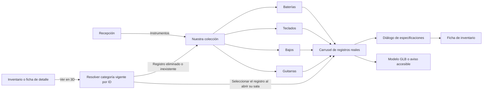

# Galería musical

## Requisitos implementados

| Requisito | Comportamiento |
| --- | --- |
| Acceso desde la recepción | El menú Instrumentos y las seis guitarras interactivas llevan a `/coleccion/`. |
| Explorar categorías | Cuatro vitrinas con su imagen aprobada, el nombre de la categoría y el enlace «Explorar colección». |
| Consultar una sala | Django muestra los registros actuales de su categoría y enlaza a las fichas. Baterías usa la clave interna `Percusion`. |
| Acceder desde Inventario | **Ver en 3D** abre el registro exacto y muestra su nombre, marca, acabado y posición. Los agotados aparecen con **Sin stock**. |
| Manipular el modelo | Cada sala carga un GLB estático y permite girarlo con arrastre, toque o flechas sobre el lienzo. La flotación puede pausarse y se desactiva con movimiento reducido. |
| Recorrer una sala | Las flechas laterales recorren todos los registros de forma circular. El modelo sale y entra desde lados opuestos y recupera la orientación inicial con el acabado de la nueva marca. |
| Consultar especificaciones | Un diálogo muestra nombre, marca, categoría, modelo y descripción, precio CLP, stock y acabado de la selección. Escape, el botón Cerrar o un clic fuera devuelven el foco al botón de apertura. |
| Continuidad de navegación | Los enlaces siguen accesibles con WebGL desactivado y en salas vacías. |

## Caso de uso · Explorar una categoría

La persona abre **Instrumentos** en la recepción y activa **Explorar colección** en una vitrina. Django valida la ruta, consulta la categoría y presenta sus registros. En la sala, la persona usa las flechas laterales y abre **Ver especificaciones** para consultar el registro activo. Cerrar el diálogo conserva la selección y su orientación. Con el lienzo enfocado, las teclas de flecha giran el modelo. El diálogo ofrece un enlace opcional a la ficha existente. **Volver a las categorías** devuelve a la galería.

Si la sala está vacía, aparece un aviso. Con un registro, la ficha está disponible y las flechas se ocultan. Una categoría desconocida devuelve 404. Si falla WebGL o la geometría, el carrusel conserva la navegación y las especificaciones sin animación. Si el módulo no carga o JavaScript está desactivado, se muestran fichas desplegables.

## Modelos de exhibición

Guitarras usa una eléctrica de seis cuerdas, Bajos un bajo de cuatro cuerdas, Teclados un instrumento digital de 88 teclas y Baterías un conjunto acústico de cinco piezas. Cada GLB representa su categoría. La batería acústica también acompaña fichas de baterías electrónicas. [Procedencia, licencias y validación](../02_arquitectura/recursos_3d.md)

## Caso de uso · Ver en 3D desde Inventario

Desde `/instrumentos/` o desde una ficha de detalle, la persona selecciona **Ver en 3D**. El enlace estable `/coleccion/instrumento/<id>/` resuelve la categoría actual en MariaDB y redirige a la sala con `?instrumento=<id>`. Si la selección no pertenece a la sala, se presenta un aviso y se muestra el primer registro disponible. Si el enlace estable apunta a un registro eliminado, lleva a las categorías. Sin JavaScript, la ficha del registro solicitado aparece desplegada.

Cada registro ocupa una posición, incluso con stock cero. El GLB base se reutiliza dentro de su categoría y el acabado se aplica según la marca. Altas, ediciones y bajas se reflejan en la siguiente consulta de la sala.

## Implementación del carrusel

`galeria.py` ordena los registros y obtiene el acabado de `presentacion.py`. `galeria-carrusel.mjs` controla la posición, la transición y el diálogo. `galeria-visor.mjs` controla giro y flotación. `galeria-glb.mjs` carga el archivo especificado por `modelos-glb.mjs`, calcula sus límites y aplica una escala uniforme que conserva las proporciones. El acabado se limita a la combinación de nodo y material configurada. La descripción sigue proporcionando el nombre comercial de la ficha.

## Revisión visual

Con Django iniciado, abre `/coleccion/` y entra a cada sala. Comprueba que el modelo, las flechas, la acción principal, el regreso y el pie se vean juntos con el navegador maximizado a 1366 × 768 y 1920 × 1080. El encabezado y el pie ocupan filas propias y el escenario toma la altura restante. Avanza en ambos sentidos y abre **Ver especificaciones**. Verifica el precio y el acabado, cierra con Escape y comprueba el foco. En ventana pequeña o con zoom alto, comprueba que la página pueda desplazarse sin recortar el modelo.

[Vistas](../../instrumentos/galeria.py) · [Plantillas](../../instrumentos/templates/instrumentos/) · [Pruebas](../07_pruebas/matriz_validaciones.md)
