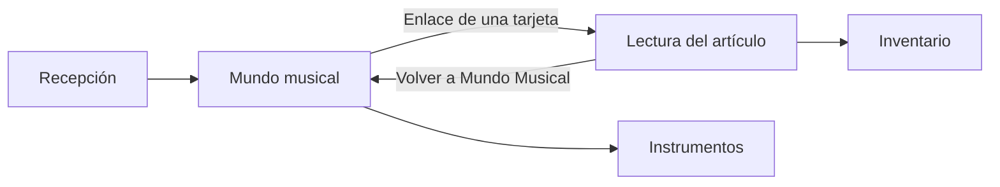

# Consultar Mundo musical

## Objetivo y requisitos

La persona que visita la tienda puede abrir doce artículos desde el menú de Recepción. La portada ofrece cuatro instrumentos, cuatro acontecimientos históricos y cuatro artículos de tecnología y curiosidades. Cada artículo tiene una URL directa, imagen, explicación con subtítulos, conclusión y fuentes verificables.

La navegación global permite acceder a Recepción, Instrumentos e Inventario. Los enlaces se operan con teclado, mouse o toque. En escritorio con espacio suficiente, el pie permanece junto al marco de lectura y el artículo se desplaza internamente. En ventanas estrechas o con zoom elevado, se permite el desplazamiento de la página.

## Flujo de consulta

1. Desde Recepción, la persona abre **Mundo musical**.
2. Selecciona una tarjeta en la portada o abre directamente el enlace compartido de un artículo.
3. Django identifica el contenido por slug y lo presenta en el área principal.
4. La persona puede enfocar el área de lectura y desplazarla con teclado.
5. **Volver a Mundo Musical** recupera la cuadrícula de doce tarjetas.

Si el identificador no existe, Django devuelve 404. La consulta no requiere una cuenta ni escribe datos.

## Contenido editorial e imágenes

Los textos están en [contenido_musical.py](../../instrumentos/contenido_musical.py). Cada entrada incluye los enlaces a su bibliografía, entre ellos The Met, Yamaha, Fender, la Biblioteca del Congreso de EE. UU., Bethel Woods, el Smithsonian, Sony, The MIDI Association, el estudio de Jakubowski y colaboradores y NIST. Los registros del CRUD siguen en MariaDB.

Las doce ilustraciones se generaron para el proyecto con ImageGen. Son escenas editoriales, incluidas las que evocan acontecimientos históricos. La lámina original se separó en doce JPEG de 380 × 337 píxeles para servirlos localmente. No se incorporaron fotografías de terceros ni se atribuye a las ilustraciones una licencia abierta. [Imágenes de Mundo musical](../../instrumentos/static/instrumentos/img/mundo/)

## Revisión visual

En Edge, abre `/mundo-musical/`, maximiza la ventana y revisa la cuadrícula a 1366 × 768 y 1920 × 1080 con la interfaz del navegador visible. Usa Tab y Enter para abrir una tarjeta. En el artículo, enfoca el área de lectura y desplázala con las teclas de dirección. Comprueba que **Volver a Mundo Musical** y el pie permanezcan visibles. Reduce la ventana o aumenta el zoom y verifica que el contenido se pueda recorrer de principio a fin.
